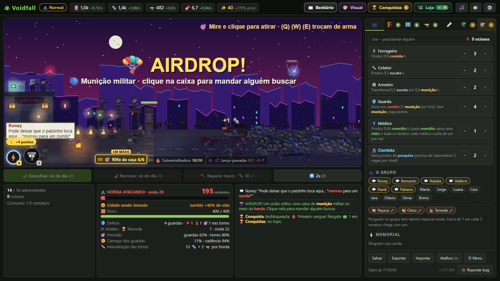
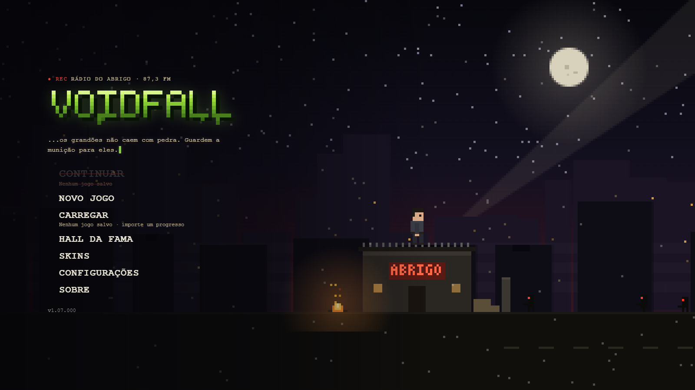
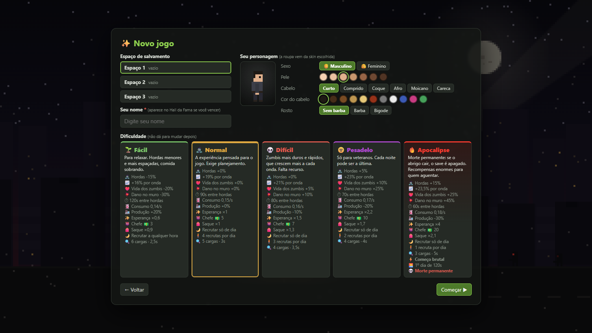
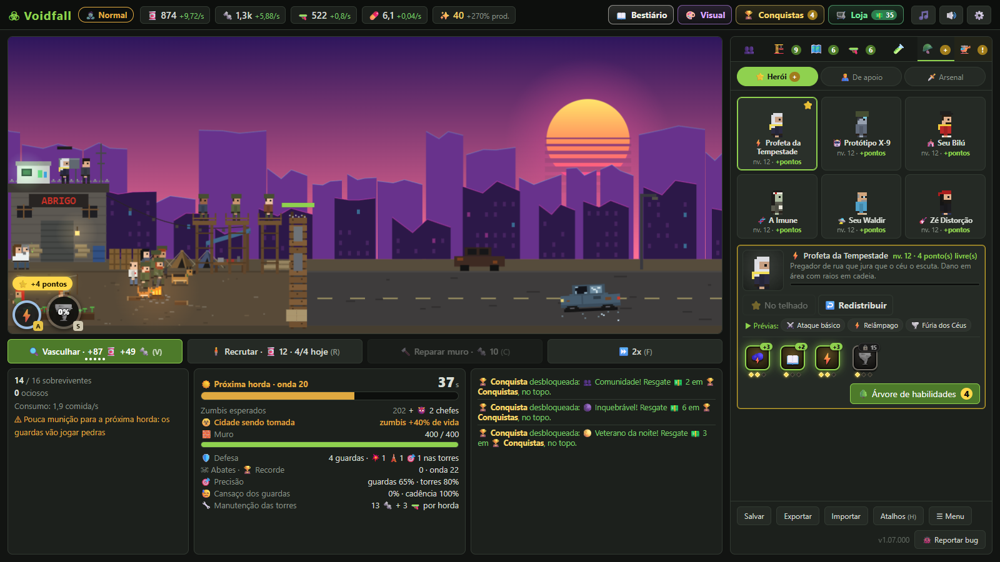
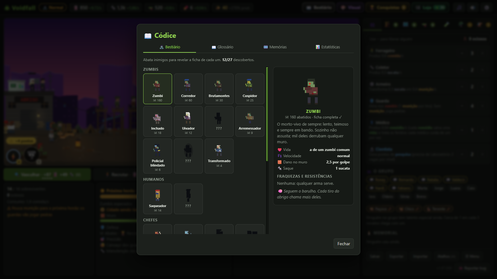
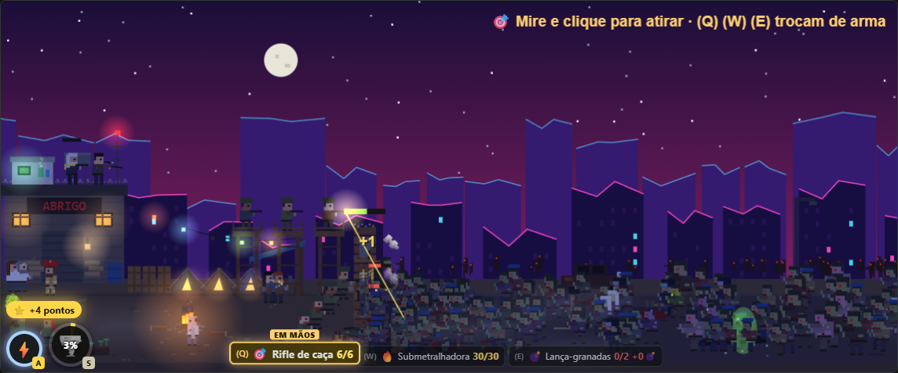

# ☣ Voidfall

Jogo idle de sobrevivência zumbi para navegador, feito em **JavaScript puro**, sem frameworks, sem bibliotecas e sem nenhum arquivo de imagem ou áudio: os gráficos em pixel art são desenhados no Canvas e toda a música e os efeitos sonoros são sintetizados em tempo real com a Web Audio API.

**[▶ Jogar agora](https://fernandofiorini.github.io/Void-Fall/)**



## Sobre o jogo

Você lidera um pequeno grupo de sobreviventes num armazém abandonado. De dia, distribui as pessoas entre funções, constrói defesas e manda expedições atrás de suprimentos. À noite, a horda ataca o muro em tempo real, e você ajuda atirando com as armas do líder, ao lado de um herói de campo no telhado.

Por trás das hordas há uma história, a do **Projeto Aurora**: o laboratório que criou o vírus e a equipe da Dra. Helena Vasconcelos, que fugiu com partes da pesquisa para cidades diferentes. Para encontrar a **Cura**, você evacua de cidade em cidade juntando cada etapa da pesquisa, contada em cutscenes de pixel art.

Com o jogo fechado, o abrigo fica parado (sem hordas e sem mortes) e rende parte da produção por até 8 horas.

| | |
|---|---|
|  |  |
| **Menu principal** com 3 espaços de salvamento, Hall da Fama e skins | **Novo jogo:** crie o personagem e escolha entre cinco dificuldades |
|  |  |
| **Exército:** seis heróis de campo, cada um com árvore de habilidades | **Códice:** bestiário, glossário, memórias da história e estatísticas |



## Destaques técnicos

- **Zero dependências e zero assets.** Todos os personagens, prédios, efeitos e o ciclo de dia e noite são desenhados com primitivas do Canvas 2D. A trilha (calma de dia, tensa durante a horda) e mais de 30 efeitos sonoros são gerados por osciladores, filtros e ruído da Web Audio API.
- **A arte da história também é código.** As cutscenes, os retratos dos heróis, as prévias animadas de armas e habilidades e os filtros visuais (TV de tubo, sépia, visão noturna...) são desenhados ao vivo, sem nenhuma imagem.
- **Simulação desacoplada da renderização.** A lógica roda pelo relógio do jogo, o que permite pausar, calcular a produção offline e resolver ondas de uma vez quando a aba fica em segundo plano. A cena anima pelo tempo real dos quadros.
- **Combate em tempo real com fallback analítico.** Ao vivo, cada zumbi, tiro e impacto é simulado. Com a aba em segundo plano, a onda é calculada por tipo de zumbi, coerente com o modo ao vivo e sem travar em ondas altas.
- **Balanceamento guiado por simulação.** As curvas de dificuldade foram ajustadas com um jogador automatizado que joga o jogo inteiro sozinho, de cidade em cidade até a Cura, em cada dificuldade.
- **Resistente a erros.** Um erro de código não trava o jogo: ele continua rodando, avisa o jogador e o erro vai anexado no Reportar bug, junto com um snapshot do save. O save tem cópia de segurança automática caso corrompa.
- **Arquitetura orientada a eventos.** A lógica emite eventos (`shot`, `zdeath`, `waveStart`…) que a cena e o áudio consomem, sem que a simulação conheça a apresentação.
- **Saves compatíveis entre versões.** O save é mesclado com o estado padrão, então campos adicionados em versões novas não quebram progressos antigos.

## Sistemas

| Sistema | Descrição |
|---|---|
| Sobreviventes | Cada um com nome, uma história curta (passe o mouse no boneco) e às vezes um talento, em seis funções (forrageiro, coletor, armeiro, guarda, médico, cientista), com consumo de comida e um memorial para quem morreu |
| Homenageados | Pessoas de verdade que entram no grupo com frases próprias, ditas em balões no cenário, e às vezes visual, roupa e história fixos (e um easter egg) |
| Pets | Cachorro, gato e pastor alemão, cada um com um bônus. Nunca morrem, seguem o grupo de cidade em cidade e aceitam carinho |
| Armas do líder | Mira manual na horda e sete armas com melhorias (da pistola à bazuca), com pente, recarga, alcance e munição especial, até 3 por noite em (Q) (W) (E) |
| Heróis de campo | Seis heróis únicos (Profeta da Tempestade, Protótipo X-9, Seu Bilú, A Imune, Seu Waldir e Zé Distorção) que lutam no telhado, sobem até o nível 20 e têm árvore de habilidades com passivas, ativa (A) e suprema (S), além de jingle e prévias animadas |
| Caixas de herói | Cada chefe derrotado deixa uma caixa que sobe de ★ a ★★★ com cliques e solta recursos, fragmentos ou um herói completo. Repetidos viram 🏷️ Tampinhas |
| Equipe de apoio | 12 heróis de apoio com visual e habilidade únicos, classe, nível e armas de quatro raridades |
| Combate | Guardas (que cansam e podem se ferir no muro) e três torres com papéis diferentes (curta, média e longa), com precisão que evolui por treinamento, pesquisa, talentos e heróis |
| Hordas | 27 inimigos: zumbis especiais (corredor, brutamontes, cuspidor, inchado, uivador, hospedeiro, gosma, policial blindado...), saqueadores humanos e 12 chefes, cada um com comportamento próprio (salta, rola, cava, se divide, bombardeia...) |
| Noites especiais | Lua de Sangue, Neblina, Horda Dupla, Chuva Ácida, Noite dos Corredores, Investida, Horda Furiosa e Noite dos Saqueadores, com alarme nas perigosas. Airdrops caem no meio da horda |
| Invasão | Se o muro cair, os zumbis entram no abrigo. Quem é alcançado morre, escapa ferido ou é mordido, e cada mordida pede uma decisão: matar (luto no grupo) ou liberar (pode voltar transformado, ou curado) |
| Cidade, pesquisa e a Cura | Expedições, distritos para libertar, laboratório com 16 tecnologias e as 5 etapas da Cura, cada uma numa cidade nova. Evacuar gera Esperança; a Cura inicia um Novo Mundo com Legado |
| Códice | Bestiário que revela cada inimigo conforme os abates, glossário de descobertas, memórias (rever as cutscenes) e estatísticas do save |
| Visual e skins | Criação do personagem (sexo, pele, cabelo, barba), 35 skins de arma e 23 de personagem (líder, grupo e heróis), três estilos de cenário e seis filtros visuais liberados ao vencer |
| Eventos | Dilemas com escolha (e tempo), acontecimentos aleatórios e um comerciante ambulante |
| Configurações | Três estilos musicais (Clássica, Synthwave e Terror), músicas para cada momento (menu, tensão, chefe), volumes separados, velocidade 2x de dia e uma aba de acessibilidade |
| Metajogo | 59 conquistas, desafios semanais e de prestígio, loja, recordes e cinco dificuldades, do 🌱 Fácil ao 🔥 Apocalipse (morte permanente) |
| Saves e vitória | 3 espaços de salvamento, dificuldade que só pode subir, arquivo de save próprio (.voidfall), cópia de segurança automática e, ao vencer, skins, filtros, Hall da Fama e o seu nome num sobrevivente lendário |
| Reportar bug | Janela no próprio jogo que envia o problema com a versão, o registro e um snapshot do save |

## Como jogar

1. No menu principal, comece um **Novo jogo**: escolha o espaço, o seu nome, o visual do personagem e a dificuldade.
2. Nas duas primeiras ondas, quem defende é você: mire e clique para atirar. Um tutorial guiado mostra o caminho.
3. Na aba **Equipe**, distribua os sobreviventes: comida primeiro, depois guardas (liberados na onda 3) e armeiros para a munição. Funções, abas e construções vão liberando conforme a onda.
4. Construa barracas para abrigar mais gente e muro e torres para aguentar as hordas. De dia, use o Vasculhar para juntar recursos.
5. Derrote chefes para ganhar caixas de herói e leve um herói de campo ao telhado.
6. Depois da onda 10, o helicóptero chega: evacue para ganhar Esperança, seguir para a próxima cidade e avançar na pesquisa da Cura.

### Atalhos de teclado

| Tecla | Ação |
|---|---|
| `1` a `0` | Trocar de aba |
| `Q` `W` `E` | Trocar de arma na horda (ou a roda do mouse) |
| `R` | Recarregar a arma na horda (de dia, recrutar) |
| `A` / `S` | Ativa e suprema do herói de campo |
| `Espaço` | Pausar / continuar |
| `V` | Vasculhar |
| `G` | Recrutar |
| `C` | Consertar o muro |
| `F` | Velocidade 2x durante o dia |
| `M` | Ligar / desligar o som |
| `O` | Abrir o comerciante |
| `B` | Códice (bestiário, glossário, memórias e estatísticas) |
| `H` ou `?` | Lista de atalhos |

### Backup do progresso

O progresso fica salvo no navegador, em 3 espaços, com uma cópia de segurança automática. Use **Exportar** no rodapé para baixar um arquivo `.voidfall` e **Importar** (no jogo ou na tela Carregar do menu) para levá-lo a outro navegador ou aparelho. Saves do 🔥 Apocalipse não podem ser exportados.

### Encontrou um bug?

Use o botão **🐞 Reportar bug** no rodapé do jogo. Ele anexa sozinho a versão, a dificuldade, o registro e um snapshot do save.

## Estrutura do projeto

```
index.html          interface e ordem de carregamento dos scripts
css/style.css       layout, tema escuro e responsividade
assets/             prints usados neste README (o jogo não usa nenhuma imagem)
js/
  config.js         constantes de balanceamento e tabelas de dados (zumbis, funções, construções, dificuldades, homenageados)
  settings.js       configurações do aparelho (áudio, estilos, filtros, acessibilidade) e a janela de configurações
  slots.js          espaços de salvamento, perfil do jogador e morte permanente
  state.js          estado do jogo, multiplicadores derivados e barramento de eventos
  unlocks.js        desbloqueio progressivo de abas, funções e construções conforme a onda
  combat.js         hordas: surgimento, movimento, tiros, dano ao muro e resolução em segundo plano
  bosses.js         comportamento próprio de cada chefe
  airdrop.js        caixas de paraquedas no meio da horda
  simulation.js     passo de simulação, progresso offline e controle de tempo
  progression.js    expedições e evacuação (prestígio)
  invasion.js       muro caído: luta dentro do abrigo, feridos, médicos e a decisão sobre os mordidos
  debug.js          menu de debug para montar cenários de teste (F9; exige DEV_MODE = true em config.js e rodar localmente)
  achievements.js   conquistas e estatísticas
  shop.js           loja e moeda rara
  actions.js        ações disparadas pelo jogador
  save.js           salvar, carregar, migrar saves antigos, exportar e importar
  bugreport.js      Reportar bug e a rede de segurança para erros
  ui.js             painéis, abas, notificações e seletor de dificuldade
  menu.js           menu principal, novo jogo, Hall da Fama e tela de vitória
  weapons.js        armas do líder: mira, tiros, explosões, fogo, munição e melhorias
  wskins.js         skins das armas do líder
  oskins.js         skins de personagem (líder, grupo e heróis)
  champions.js      heróis de campo: ataque no telhado, XP, árvore de habilidades, ativa (A) e suprema (S)
  endgame.js        pesquisa, a Cura, noites especiais, distritos, heróis de apoio e desafios semanais
  events.js         dilemas com escolha e comerciante ambulante
  pets.js           cachorro, gato e pastor alemão
  honored.js        sobreviventes homenageados: frases, histórias e easter eggs
  story.js          cutscenes da história (o Projeto Aurora)
  codex.js          Códice: bestiário, glossário, memórias e estatísticas
  tutorial.js       dicas do primeiro jogo e atalhos de teclado
  guide.js          tutorial guiado das duas primeiras ondas
  demos.js          prévias animadas de armas, itens da loja, pesquisas e habilidades
  scene.js          renderização em pixel art no Canvas, com três estilos visuais
  vfilter.js        filtros visuais por cima da cena (TV de tubo, sépia, visão noturna...)
  audio.js          música generativa em três estilos e efeitos sonoros sintetizados
  main.js           inicialização, laço principal e contador de visitas
tools/
  bot.js            jogador automatizado para testar o equilíbrio e analisar saves (roda no Node, só quando chamado)
```

Os scripts são carregados em ordem pelo `index.html`, sem etapa de build.

## Jogador automatizado (equilíbrio)

`tools/bot.js` carrega o jogo de verdade no Node, sem navegador, e joga sozinho **ao vivo** (zumbi por zumbi): repara o muro, recruta, distribui funções e constrói (defesa primeiro quando ela está apertada). No fim, mostra para cada dificuldade a melhor onda, as quedas do abrigo, as mortes, as construções, a razão defesa ÷ ameaça, o cansaço dos guardas e a evolução a cada 10 minutos. Uma hora de jogo leva menos de um segundo.

```bash
node tools/bot.js                          # 60 min em cada dificuldade
node tools/bot.js --min 120 --dif normal   # 2h só no Normal
node tools/bot.js --cidade 5 --clicar      # cidade 5 (zumbis mais fortes), vasculhando 1x/s
node tools/bot.js --campanha 6 --dif normal                       # 6 cidades seguidas, evacuando
node tools/bot.js --completo --campanha 8 --dif normal --min 90   # teste completo, até a Cura
```

Sem `--completo`, ele mede a defesa de um jogador passivo: não usa as armas do líder, não faz expedições nem pesquisa.
Com `--completo`, joga tudo: laboratório, pesquisa e a Cura (cada etapa antes de evacuar da cidade), expedições, distritos, armas do líder, comerciante, dilemas e mordidos (escolha sorteada), heróis de campo (habilidades e pontos) e heróis de apoio. O relatório mostra, por cidade, as etapas da Cura, pesquisas, expedições, distritos, armas, trocas, dilemas e, no fim, em quanto tempo a Cura foi encontrada (em tempo de jogo e em tempo real, usando o 2x de dia). `--desafios N` aceita N desafios sorteados em cada cidade nova.

### Analisar o save de um jogador

Quando alguém manda um save (o arquivo `.voidfall`, um `.txt` exportado ou o **texto inteiro do e-mail do Reportar bug**, salvo num arquivo), o bot abre esse save, confere se há valores quebrados (recursos NaN ou negativos, funções a mais que pessoas, muro acima do máximo, caixas inválidas...), continua jogando a partir dele e registra qualquer erro de código:

```bash
node tools/bot.js --save saves-recebidos/relatorio.txt               # 30 min a partir do save
node tools/bot.js --save saves-recebidos/ana.voidfall --min 60 --completo
```

O relatório mostra o estado antes e depois, a evolução a cada 5 min, os últimos avisos ruins do registro e o diagnóstico: cada erro (com onde aconteceu e quantas vezes) e cada valor quebrado (desde quando). Se houver erro de código, o comando termina com código 2. Guarde os saves recebidos na pasta `saves-recebidos/`, que fica fora do git (eles têm o nome dos jogadores).

## Rodando localmente

Não há dependências. Basta abrir o `index.html` no navegador.

Se preferir um servidor local:

```bash
npx serve .
# ou
python -m http.server
```

## Publicando no GitHub Pages

1. Envie o projeto para um repositório no GitHub.
2. Em **Settings → Pages**, escolha **Deploy from a branch**, a branch `main` e a pasta `/ (root)`.
3. Após alguns minutos o jogo fica disponível em `https://fernandofiorini.github.io/Void-Fall/`.

## Versionamento

A versão atual aparece no rodapé do jogo e o histórico está no [CHANGELOG](CHANGELOG.md). O formato é `MAIOR.MÉDIA.PEQUENA` (ex.: `1.00.000`): ajustes sobem o último número, novos recursos sobem o do meio e as maiores atualizações sobem o primeiro.

## Tecnologias

HTML5 · CSS3 · JavaScript (ES2020) · Canvas 2D · Web Audio API · localStorage
